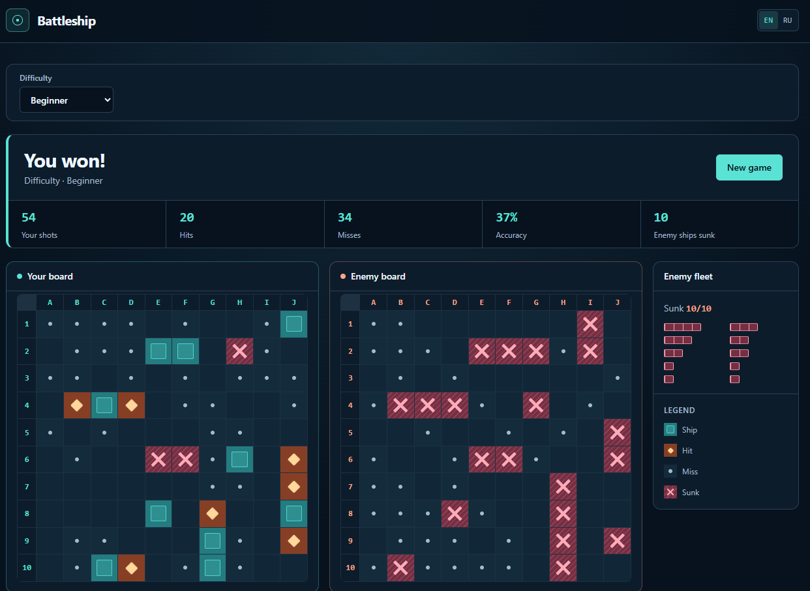
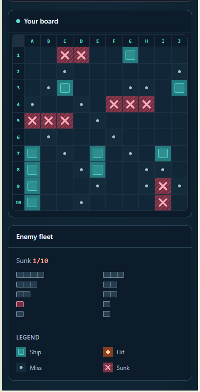

# Battleship Lab

Battleship Lab is a browser-based Battleship game against a computer opponent. It uses Angular and Tailwind CSS for the interface, Fastify for the API, and a shared TypeScript game engine.

## How to play

1. Choose a difficulty (Beginner, Medium, or Hard) and select **New game**.
2. Select **Deploy fleet** to randomly place your ships, then select **Start battle**.
3. Fire by selecting a cell on the enemy board. Use the board legend to distinguish hits, misses, and sunk ships.
4. After a win or loss, review your shots, hits, misses, accuracy, and the number of enemy ships sunk. Select **New game** to play again.

The interface is available in **English (EN)** and **Russian (RU)**. English is the default. Use the language switcher in the header to change languages during a match. Your choice is saved in the browser for future visits.

## Screenshots

### Desktop



### Mobile



## Run locally

Use Node.js 22 (see [`.nvmrc`](.nvmrc)) and npm.

```bash
npm ci
npm run build
```

Start the API and web app in separate terminals.

```bash
npm run dev:api
```

```bash
npm run dev:web
```

Open the [game](http://localhost:4200) in your browser. The API exposes a [health endpoint](http://localhost:3000/health).

Run `npm test` to check the game engine, API and bots, and frontend localization.

## Project structure

- `frontend` — Angular interface, Tailwind styles, and EN/RU translations.
- `backend` — Fastify API and bot strategies.
- `packages/core` — game rules, fleet generation, and game sessions.
- `packages/contracts` — shared TypeScript types for the API and game engine.


## AI-Assisted Development

Battleship Lab was developed as a practical experiment in AI-assisted software engineering using **OpenAI Codex**.

The project explores how AI coding agents can contribute to full-stack development while working within explicit architectural constraints, coding standards, and verification requirements.

The development workflow includes:

- **OpenAI Codex** for implementation, refactoring, UI improvements, localization, and automated testing.
- **AGENTS.md** for repository-level instructions, development conventions, and architectural boundaries.
- **Agent Skills** for specialized Angular, API, and testing guidance.
- **Task-driven development** using versioned Markdown specifications in `docs/tasks/`.
- **Human-in-the-loop development**, including technical decision-making, code review, functional testing, and acceptance of changes.
- **AI-assisted UI/UX development**, including responsive layouts, interactive feedback, accessibility considerations, and bilingual localization.

The application uses a conventional TypeScript game engine and algorithmic computer opponents. **Gameplay does not depend on an LLM or external AI inference API.**

The goal of the experiment is to evaluate the effectiveness of AI coding agents in a structured software engineering workflow, rather than to introduce AI where deterministic algorithms are sufficient.


See the [game rules](docs/GAME_RULES.md), [API reference](docs/API.md), and [architecture overview](docs/ARCHITECTURE.md).